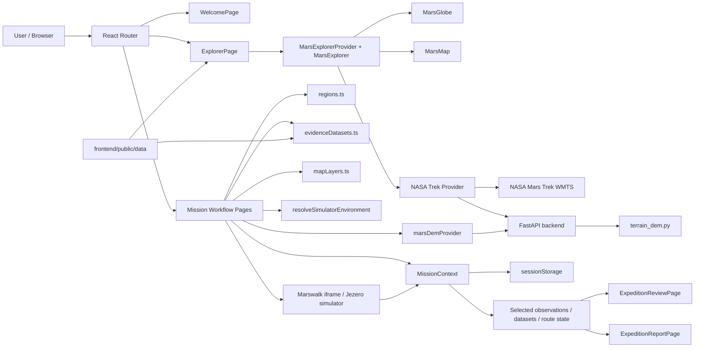
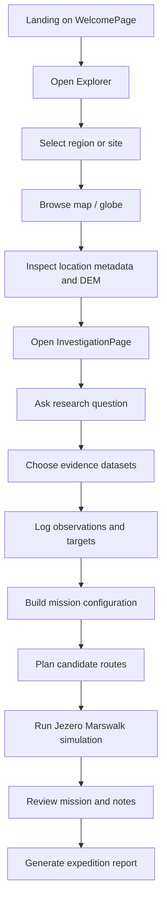

# Mars Explorer — System Architecture and Masterplan

## 0. Actual repository structure

```text
NASAMartianMap/
├── .venv/
├── backend/
│   ├── main.py
|   |── terrain_dem.py
|   ├── data-processing
|   |   ├── acquisition
|   |   |   |── download_meda_test.py
|   |   |   └── discover_hirise_dtm.py
|   |   ├── processing
|   |   |   └── process_meda.py
|   |   └── validation
|   |       ├── inspect_remote_dem.py
|   |       └── test_dem_coordinate.py
|   └── datasets
|       ├── meda
|       |   |── processes
|       |   |── indexes
|       |   └── raw
|       └── rover_imagery
|           |── raw
|           └── indexes
└── frontend
    ├── dist
    ├── node_modules
    ├── public
    └── src
        ├── app\routes
        │   └── AppRoutes.tsx
        ├── components
        │   |── layout
        |   |   |── AppLayout.tsx
        │   |   └── Header.tsx
        │   |── map
        |   |   |── MarsMap.css
        |   |   |── MarsMap.tsx
        |   |   └── RouteMap.tsx
        │   └── ui
        |       └── index.tsx
        ├── data
        │   |── mapLayers.ts 
        |   |── explorationSites.ts
        |   └── marsLocations.ts
        ├── features
        |   ├── mission
        │   │   |── EvidenceInspectorPage.tsx
        │   │   |── ExpeditionReportPage.tsx
        │   │   |── ExperiditionReviewPage.tsx
        │   │   |── InvestigationPage.tsx
        │   │   |── KnowledgeGapsPage.tsx
        │   │   |── missionHelpers.ts
        │   │   |── MissionLayout.tsx
        │   │   |── RoutePlannerPage.tsx
        │   │   └── workflow.ts
        │   ├── planetary-explorer
        │   │   |── LocationPage.tsx
        │   │   └── ExplorerPage.tsx
        │   └── welcome
        |       |── Welcomeassets
        │       |── WelcomePage.css
        │       └── WelcomePage.tsx
        ├── globe
        │   ├── components
        │   ├── utils
        │   ├── MarsGlobe.css
        │   ├── MarsSurface.tsx
        │   └── MarsGlobe.tsx
        ├── mars_walking
        │   ├── main.ts
        │   └── style.css
        ├── services
        │   |── providers
        │   |   ├── nasaTrek.ts 
        │   |   └── marsDem.ts
        │   └── dataProviders.ts 
        ├── simulator\jezero-crater
        │   |── scripts
        │   |   ├── build-jezero.mjs
        │   |   └── jezero_simulator.html
        │   └── src
        │       └── jezero_main.ts
        ├── state\mission
        │   └── MissionContext.tsx
        ├── styles
        │   └── theme.css
        ├── three\globe
        │   └── MarsGlobe.tsx
        ├── types
        │   ├── assets.d.ts
        │   └── index.ts
        ├── App.css
        ├── App.tsx
        ├── index.css
        └── main.tsx
    ├── index.html
    ├── package-lock.json 
    ├── package.json 
    ├── tsconfig.json 
    ├── vite.config.ts
    ├── scripts
├── .gitignore
├── ARCHITECTURE.md
├── LICENSE
├── notes.md
├── README.md
├── skills-lock.json
└── verify_phase1_multiregion.mjs
```

## Executive summary

This project is a browser-based Mars exploration and scientific investigation workspace. The codebase is not a finished product in the traditional sense; it is a working front-end prototype and research architecture that combines:

- interactive planetary browsing using NASA Mars Trek map layers,
- a mission state model that tracks objective, region, evidence, targets, routes, and simulation state,
- a scientific evidence catalog that distinguishes empirical datasets from map visualization layers,
- a Jezero-focused 3D surface simulation and EVA workflow,
- a route-planning and expedition review workflow for future mission operations.

The actual implementation is strongest in the following areas:

- app shell and routing,
- region registry and evidence cataloging,
- discovery, mission state, observation logging, and route planning,
- Jezero Crater simulator availability,
- real NASA WMTS layer loading and local DEM queries.

The actual implementation is weakest in the following areas:

- complete 3D scene integration for all regions,
- end-to-end backend dataset ingestion and archive validation,
- complete rover imagery catalog integration,
- full multi-region simulator support,
- true report generation and AI-based scientific conclusion workflows.

The architecture is intentionally designed around a staged workflow: Discover → Investigate → Analyze → Plan → Simulate → Review → Report. The README states the full product direction, but the code confirms that the present application is mostly at the discovery/investigation/planning stage, with a functioning Jezero simulator sandbox rather than a mature production multipurpose mission simulator.

---

## 1. Actual project structure and responsibilities

### Root and configuration

- `frontend/package.json` defines the React + Vite front-end toolchain.
- `frontend/tsconfig.json` and `vite.config.ts` configure TypeScript and the dev server.
- `backend/main.py` exposes a minimal FastAPI app for layer metadata and terrain DEM endpoints.
- `backend/terrain_dem.py` registers the DEM API used by the front-end when querying local or remote elevations.
- `backend/data-processing/...` contains scientific data acquisition/processing pipelines for MEDA and HiRISE-related DEM validation.
- `frontend/public/data/...` contains locally bundled datasets such as Jezero geologic GeoJSON and imagery bundle metadata.

### Front-end architecture

The front-end is a single-page React app built around `App.tsx` and `app/routes/AppRoutes.tsx`.

- `App.tsx` wraps the app in `MissionProvider` and `BrowserRouter`, then renders `AppRoutes`.
- `AppRoutes.tsx` defines the actual route tree.
- `components/layout/AppLayout.tsx` and `Header.tsx` create the reusable shell and page framing.
- `features/welcome/WelcomePage.tsx` is the landing page and high-level workflow entry.
- `features/planetary-explorer/ExplorerPage.tsx` renders the main exploration workspace.
- `features/mars-explorer/*` contains the interactive globe/map explorer transitions and selection logic.
- `features/mission/*` contains the investigation, targeting, route planning, simulation, review, and report workflow.
- `state/mission/MissionContext.tsx` is the core shared state provider for mission objective, active region, datasets, observations, routes, and simulation telemetry.
- `services/providers/...` retrieves NASA map metadata and local DEM elevations.
- `data/regions.ts` is the canonical Mars region registry.
- `data/evidenceDatasets.ts` is the evidence catalog and data classification system.
- `data/mapLayers.ts` is the layer catalog for NASA visualization basemaps and overlays.
- `simulator/...` contains the Jezero simulator environment and staged future region simulators.
- `globe/*` and `three/globe/*` contain three-dimensional globe views; the code is present, but the app does not yet use a fully complete cross-region 3D terrain engine everywhere.

### Backend architecture

The Python backend is intentionally lightweight and service-oriented, not a full scientific data lake.

- `backend/main.py` provides:
  - a root health endpoint,
  - `/api/layers` to list Mars Trek layers,
  - `/api/layers/{layer_id}` to inspect a specific layer,
  - CORS configuration for local dev and deployment.
- `backend/terrain_dem.py` provides terrain/elevation endpoints for DEM access and coordinate queries.
- `backend/data-processing/...` supports dataset extraction and validation rather than being the active application runtime.

This is a classic “thin backend + rich front-end” design, with the backend used for metadata and DEM access rather than core domain logic.

---

## 2. Actual architecture and dependency direction



### Dependency direction

The actual dependency graph is broadly front-end-first:

- React pages depend on data registries and mission state.
- mission state depends on region and dataset metadata.
- the map and explorer depend on NASA data providers and local DEM service.
- the simulator depends on environment configuration and mission state via `window.postMessage`.
- the backend is a supporting service, not the application’s core logic engine.

### Architectural coupling and hardcoded assumptions

There are several important constraints and couplings visible in code:

1. Jezero is treated as the default and canonical active region in many UI flows.
   - `activeRegionId = mission.region?.id ?? "jezero-crater"`
   - default dataset selection often falls back to Jezero assets if no valid region selection is present.

2. Map layers and scientific evidence data are intentionally separated.
   - `mapLayers.ts` is strictly visual context.
   - `evidenceDatasets.ts` is empirical evidence and scientific interpretation.

3. simulator availability is deliberately strict.
   - Only `jezero-crater` resolves to an actual simulator environment.
   - Gale/Valles/Olympus are registered as `PLANNED` and do not receive a fallback environment.

4. mission state persists in `sessionStorage`, which keeps candidate routes, observations, and mission metadata between page transitions but does not fully represent a persistent backend mission system.

5. the application still has placeholder pages and partial integrations where later workflow stages are expected but not fully implemented.

---

## 3. Route architecture and page-by-page status

### Registered routes from `AppRoutes.tsx`

| Route | Page | Purpose | Status |
| --- | --- | --- | --- |
| `/` | `WelcomePage` | landing page and workflow overview | Implemented |
| `/explorer` | `ExplorerPage` | 2D/3D planetary discovery workspace | Implemented |
| `/explorer/location/:siteId` | `LocationPage` | location detail and expedition launch | Implemented |
| `/globe-test` | `GlobeTestPage` | raw globe rendering test/debug route | Implemented as a test route |
| `/login` | `LoginPage` | auth entry | Present but not central to core workflow |
| `/register` | `RegisterPage` | registration route | Present but not central to core workflow |
| `/mission` | redirect | canonical mission landing | Implemented as a redirect |
| `/mission/investigate` | `InvestigationPage` | question framing, dataset selection, observation logging | Implemented |
| `/mission/evidence` | `EvidenceInspectorPage` | evidence inspection and dataset review | Implemented |
| `/mission/gaps` | `KnowledgeGapsPage` | science gaps and unknowns | Implemented |
| `/mission/builder` | `MissionBuilderPage` | expedition setup | Implemented |
| `/mission/route` | `RoutePlannerPage` | traverse route planning | Implemented |
| `/mission/simulate` | `MarswalkPage` | Jezero EVA simulator | Implemented for Jezero |
| `/mission/review` | `ExpeditionReviewPage` | review of mission summary and outputs | Implemented |
| `/mission/report` | `ExpeditionReportPage` | final report workspace | Implemented as a report surface |

### Page responsibilities and actual behavior

#### `WelcomePage`

- marketing + orientation page,
- introduces the science workflow,
- links to exploration, mission workspace, and simulator,
- surfaces the staged pipeline in `WORKFLOW_STEPS`.

Status: implemented and functioning.

#### `ExplorerPage` and `MarsExplorer`

- splits the discovery workspace into globe/map modes,
- handles selected location, saved locations, and map navigation,
- loads NASA WMTS metadata via provider,
- resolves DEM elevations using the backend service,
- supports conversion between globe and map focus states.

This is the heart of the “discover” stage.

Status: implemented and actively used.

#### `InvestigationPage`

- active region drives dataset applicability,
- dataset filters, search, and progressive disclosure are supported,
- observations can have coordinates, date, description, and provenance,
- targets and hypotheses can be added to mission state,
- scientific evidence categories are displayed and mapped to regional dataset availability,
- references to CRISM and MEDA are handled in a data-aware way.

This is the principal scientific evidence entry point and is substantially implemented.

#### `EvidenceInspectorPage` / `KnowledgeGapsPage`

- help the user inspect specific evidence or compare gaps,
- tie dataset availability and limitations to scientific questions,
- rely on the evidence registry and dataset metadata rather than live DB records.

Status: present and conceptually complete but dependent on the evidence data model rather than a full backend-driven research stack.

#### `MissionBuilderPage`

- configures objective, target selection, route constraints, equipment, and EVA assumptions,
- saves mission configuration inside `MissionContext`.

Status: implemented and functional in the front-end state model.

#### `RoutePlannerPage`

- constructs candidate routes using mission targets and waypoints,
- computes route distance using Mars spherical geometry,
- tries to query DEM data when inside Jezero validation bounds,
- audits route items for cross-region leakage and region-bound mismatches,
- distinguishes region-local route metrics from coarse approximations.

Status: implemented and reasonably complete for the current phase.

#### `MarswalkPage`

- launches a Jezero-focused simulator via an iframe, 
- receives `window.message` events from the simulator,
- records notes, recorded observations, samples, and telemetry,
- updates mission state (progress, visited targets, suit telemetry, environment conditions).

This is the most advanced behavioral workflow currently in the codebase.

Status: implemented and available for Jezero; other regions are not supported.

#### `ExpeditionReviewPage` and `ExpeditionReportPage`

- present the formed expedition narrative,
- prepare a reporting interface for mission summary, risk, and evidence accumulation.

These pages exist as part of the intended product flow, but they are conceptually a reporting layer rather than a mature publication pipeline.

Status: present, but not a full AI-generated or backend-backed report engine.

---

## 4. Scientific data architecture

The project has a clear three-catalog separation that is important to the design:

### Catalog 1: Map layer catalog (`data/mapLayers.ts`)

Purpose: visual base maps and overlays for mapping and globe presentation.

Examples:

- `jezero_hirise`
- `mars_global_mola`
- `mars_themis_day`
- `mars_themis_night`

These are treated as visualization products. A layer may be available in the UI even while being explicitly excluded from scientific evidence interpretation.

### Catalog 2: Scientific evidence dataset catalog (`data/evidenceDatasets.ts`)

Purpose: structured evidence products and measurements; these are the actual scientific records used by observation and mission planning.

Examples:

- `hirise_jezero_dtm`
- `ctx_jezero_dtm_20m`
- `mars_mola_roughness`
- `crism_jezero_vnir`
- `m2020_meda_env`

This catalog contains:

- dataset metadata,
- coverage scope,
- region applicability,
- suitability tier,
- operational status,
- limitations,
- provenance,
- integration status labels.

This is the most rigorous scientific architecture in the codebase.

### Catalog 3: Surface imagery catalog (in the same evidence file)

Purpose: represent rover imagery and camera metadata from Perseverance, without conflating surface photo records with orbital datasets or basemaps.

The code expects a clear separation between:

- orbital map visualization,
- scientific evidence datasets,
- in-situ rover imagery.

This architecture is intended but not fully fleshed into a complete archive-backed gallery system.

---

## 5. Mission and state architecture

### Shared mission state

`MissionContext.tsx` holds the central state for the application’s scientific workflow. It tracks:

- active region,
- selected datasets,
- selected observations,
- scientific targets,
- knowledge gaps,
- route candidates,
- current simulation state,
- temporal context,
- field notes,
- mission configuration,
- report state.

This mission model is the application’s canonical domain object. It is persisted to `sessionStorage` under a versioned key (`mars-explorer-active-mission-v1`).

### State transitions and flow

The mission state is shaped through the following sequence:

1. User selects a region or location in the explorer.
2. User enters an investigation question and chooses datasets.
3. User logs observations and creates targets.
4. User creates or selects route waypoints.
5. User configures mission constraints and equipment.
6. User enters the simulator or planning environment.
7. Data is updated by simulator messages and mission actions.
8. Review and report pages consume the shared mission state.

### How mission state reacts to region switching

`setRegion()` in `MissionContext.tsx` does the following:

- canonicalizes the region ID,
- updates `mission.region`,
- resets simulation position metrics when switching to another region,
- preserves shared mission data such as observations unless the UI explicitly filters them.

This ensures that region switching changes conditions without silently fabricating a different terrain environment.

---

## 6. Region architecture

### 6.1 Central registry

The source of truth for regions is `frontend/src/data/regions.ts`.

This registry contains:

- `MARS_REGIONS`, a map keyed by `id`,
- `MARS_REGION_LIST`, a list of region objects,
- `getMarsRegionById()` for canonical lookup,
- `getMarsRegionByName()` for human-readable lookup,
- `isWithinRegionBounds()` for geographic filtering logic,
- region aliases such as `jezero`, `gale`, `valles`, and `olympus`.

### 6.2 Region ids and metadata

Canonical IDs used by the app include:

- `jezero-crater`
- `gale-crater`
- `valles-marineris`
- `olympus-mons`
- `nili-fossae`
- `syrtis-major`

Each region includes:

- name,
- coordinate center,
- description,
- scientific significance,
- geographic bounds,
- simulator availability,
- local elevation datasets,
- geological data references,
- map layers,
- rover metadata,
- data limitations,
- scientific references.

### 6.3 Availability vs scientific readiness vs 3D simulator availability

The project explicitly distinguishes these values:

- region availability: whether that region is a known part of the application registry.
- scientific exploration availability: whether the region has evidence/catalog support and can be investigated.
- dataset availability: whether relevant datasets are registered and applicable.
- 3D simulator availability: whether a real 3D environment and simulator surface domain exist.

This distinction is necessary because many regions have catalog data but no simulator environment.

For example:

- Gale has region and scientific exploration support.
- Gale does not have a live 3D simulator environment.
- Jezero has both scientific exploration support and an active simulator environment.

### 6.4 Strict simulator rule

The simulator environment registry (`simulator/environments/catalog.ts`) explicitly states:

- Jezero is the only available simulation environment.
- Non-Jezero regions never fall back to Jezero.
- `available` is only true if a verified environment exists.

This is an important design guardrail: the code avoids fabricated geometry or invalid region assumptions.

---

## 7. Region comparison matrix

| Region | Geographic profile | 2D map availability | Scientific exploration | Registered datasets | 3D simulator status | Key limitation |
| --- | --- | --- | --- | --- | --- | --- |
| Jezero Crater | Ancient crater, delta-lake system | Yes | Yes | High-resolution CTX/HiRISE DEM, geologic map, MEDA context, CRISM reference | Available | Most mature environment but still not a full mission-agnostic pipeline |
| Gale Crater | Sedimentary mound, Mount Sharp | Yes | Yes | MOLA, HRSC, global context, geologic references | Planned | Not yet backed by a real 3D environment |
| Valles Marineris | Canyon system | Yes | Yes | MOLA and regional HRSC context, geologic references | Planned | No in-situ rover imagery or full terrain simulator |
| Olympus Mons | Shield volcano | Yes | Yes | MOLA and regional context, geologic references | Planned | Extreme altitude and no in-situ surface simulation support |
| Nili Fossae | Mineralogy-rich graben | Yes | Yes | Orbital references and global data | Unavailable | No rover observations and no simulator |
| Syrtis Major | Basaltic volcanic plain | Yes | Yes | Global and TES mineral context | Unavailable | No rover observations and no simulator |

The four primary regions for the masterplan are Jezero, Gale, Valles Marineris, and Olympus Mons. The code also contains two additional scientific reference regions, Nili Fossae and Syrtis Major, which are registered for orbital/scientific exploration but not as active mission-simulator landscapes.

---

## 8. User journey and workflow

### End-to-end workflow



### Actual implemented flow

The code supports the following real chain:

- `WelcomePage` → `ExplorerPage` → `MissionBuilderPage` → `RoutePlannerPage` → `MarswalkPage` → `ExpeditionReviewPage`/`ExpeditionReportPage`

The implementation is strongest for:

- discovery,
- evidence selection,
- route design,
- Jezero simulation,
- mission review.

The unimplemented or partial parts are:

- deep integration of all datasets into the report pipeline,
- actual 3D renderers for all regions,
- persistent backend mission server,
- automatic scientific conclusions or gap resolution AI workflows.

---

## 9. Actual functionality status

### Implemented and active

- route-based React app shell,
- NASA Mars Trek WMTS layer loading,
- region registry and metadata system,
- evidence catalog with dataset filtering,
- Jezero location and mission state support,
- DEM query path and fallback handling,
- route distance calculations and cross-region auditing,
- Marswalk simulator hook and mission update listener,
- Jezero-only 3D surface layer environment.

### Partially implemented

- multi-region scientific exploration beyond Jezero,
- rover imagery catalog integration,
- full mission report generation,
- complete multi-region simulator architecture,
- backend-backed archive integration beyond the DEM API.

### Planned / not yet implemented

- Gale/Valles/Olympus simulator datasets,
- larger scientific dataset processing pipeline,
- persistent cloud-backed research archive,
- automated scientific synthesis and conclusion generation,
- CAIO-style mission insight engine.

---

## 10. Masterplan recommendations

The most important near-term direction is to respect the architecture that already exists rather than creating a parallel system.

### Priority path

1. Keep the canonical region registry and mission state as the source of truth.
2. Keep map layer and evidence dataset catalogs separate.
3. Expand only the simulator environment registry for additional regions once the required digital elevation and texture assets exist.
4. Keep the backend thin and deterministic; do not move mission logic into an unbounded API schema before the app semantics are stable.
5. Treat the current Marswalk simulation as a Jezero-specific proof of concept, not a global simulator system.

### Product roadmap by stage

- Stage 1: solidify evidence and region filters, route validation, and mission review UI.
- Stage 2: expand simulation environments to Gale, Valles, and Olympus only after asset validation and region-specific DEM acceptance.
- Stage 3: integrate rover imagery and backend archive services.
- Stage 4: produce final expedition reports and scientific synthesis from structured evidence.

The design is already aligned with this staged progression.

---

## 11. Bottom line

The project is a real and coherent Mars exploration application framework, built around a region-aware mission state and scientific evidence architecture. Its best-developed shape is a front-end research workspace for Mars discovery, evidence capture, route planning, and Jezero EVA simulation.

Its important caution is that the project is not yet a full end-to-end scientific mission platform. It contains the architectural foundations for one, but the actual production-grade features remain staged and region-limited.

In other words: the app is already a convincing science-exploration prototype, but the complete “discover → investigate → analyze → plan → simulate → review → report” pipeline is intentionally future-facing rather than fully realized in code.
