# MARS EXPLORER — MASTER PROJECT COMPLETION PLAN
**Document Identifier:** `MASTER_PROJECT_COMPLETION_PLAN.md`  
**Date:** November 15, 2026  
**Role:** Lead Software Architect, Planetary-Science Research Assistant, Full-Stack Developer, Integration Engineer & QA Engineer  
**Status:** Consolidated Master Pre-Execution Baseline (Stage 1 — Read-Only Audit & Execution Plan)  
**Target Milestone:** Full Mars Explorer Application Completion (Phases 2.3A through 3.0)

---

## 1. Executive Summary & Architectural Vision

The Mars Explorer application is transitioning from a single-region prototype centered on Jezero Crater into a unified, scientifically defensible, multi-region planetary exploration workspace supporting four primary exploration regions:
1. **Jezero Crater (Octavia E. Butler Landing & Western Delta)**
2. **Gale Crater (Bradbury Landing & Aeolis Mons / Mount Sharp)**
3. **Valles Marineris (Melas Chasma Canyon System)**
4. **Olympus Mons (Summit Caldera & Volcanic Flank)**

The fundamental architectural principle of this system is:
$$\text{Simulator Availability} \neq \text{Scientific Dataset Availability}$$

A region can possess rich empirical and orbital scientific datasets (topography, thermal inertia, mineralogy, surface imagery, atmospheric telemetry) while its 3D interactive surface simulator is in development (`PLANNED`). Conversely, no region may ever present synthetic or placeholder data as verified physical measurements.

This master plan consolidates all previous phase reports, architectural audits, scientific research documents, and preflight assessments into a single, cohesive, dependency-ordered roadmap. It establishes the baseline of what is genuinely complete, identifies all remaining work, defines strict acceptance criteria, analyzes scientific and technical blockers, and provides the step-by-step execution protocol for completing the entire application.

---

## 2. Comprehensive Repository Baseline Audit

An exhaustive physical inspection of the repository (source code, public assets, backend scripts, and automated tests) establishes the ground-truth status of the project:

### 2.1 Completed and Verified Work
1. **Application Shell, Routing & Frame:**
   - React 18 + Vite + TypeScript single-page application architecture.
   - Clean route tree in `frontend/src/app/routes/AppRoutes.tsx` supporting `/`, `/explorer`, `/explorer/location/:siteId`, `/mission/*` (investigate, evidence, gaps, builder, route, simulate, review, report).
   - Reusable application layout (`AppLayout.tsx`, `Header.tsx`, `Navigation.tsx`).
2. **Phase 1 Multi-Region Foundation Architecture:**
   - Canonical region model in `frontend/src/types/region.ts` and `frontend/src/data/regions.ts` supporting all 4 regions with verified bounding coordinates and datum specifications (IAU 2000 Mars planetocentric, MOLA areoid vertical datum).
   - Strict simulator availability policy in `frontend/src/simulator/environments/catalog.ts`: non-Jezero regions return `available: false`, `environment: null`, and a planned availability notice. Zero accidental coordinate overwrites to Jezero defaults on region switch.
   - Reusable `MissionContext.tsx` supporting region switching, target persistence, candidate route waypoints, and observation logging stored in `sessionStorage`.
3. **Phase 2.1 & 2.2 Scientific Dataset Catalog & Reference Cleanliness:**
   - **Option B (Clean References-Only Architecture)** implemented and verified:
     - Jezero retains authentic USGS SIM 3464 GeoJSON (`/data/jezero_geology_sim3464.geojson`, 5.92 KB).
     - Gale Crater, Valles Marineris, and Olympus Mons have strictly empty `geologicalDatasets: []` (zero false GeoJSON declarations).
     - Deprecated identifiers (`usgs_sim_3482_gale`, `usgs_i2614_valles`, `usgs_i2502_olympus`) and erroneous terrestrial references (Oklahoma, Kilauea, South Carolina) are 100% eliminated.
     - Authoritative peer-reviewed publications and official USGS maps properly cited in `scientificReferences`:
       * *Gale:* Anderson & Bell (2010), Scott & West (1978) USGS I-1111 (scale 1:5,000,000), Grotzinger et al. (2014), Vasavada et al. (2014).
       * *Valles Marineris:* Witbeck, Tanaka, & Scott (1991) USGS I-2010 (scale 1:2,000,000).
       * *Olympus Mons:* Mouginis-Mark (2021) USGS SIM 3470 (scale 1:200,000), Morris & Tanaka (1994) USGS I-2327.
   - 17 total catalog datasets in `evidenceDatasets.ts` with strict geographic bounds vs. latitude limit filtering (`isDatasetApplicableToRegion`).
   - Reconciled MEDA counts: 53,263 raw PDS4 records across 7 sensor subsystems downsampled to 989 packaged sample observations in `meda_processed_bundle.json`.
4. **Jezero Crater 3D Surface Simulator:**
   - Fully operational 16-bit binary DEM pyramid (`/public/jezero/height/*.u16`, `overview.u16`, `manifest.json`) and 5 m CTX orthomosaic (`/public/jezero/tex/*.jpg`, `overview.jpg`) totaling 725 files (101.49 MB).
5. **Interactive Global Map Layers:**
   - 10 NASA Mars Trek WMTS basemaps and overlays operational via `frontend/src/data/mapLayers.ts`.
6. **Passing Test Suites (126 Automated Assertions):**
   - `verify_phase2_catalog.mjs`: 36 / 36 passed.
   - `verify_phase1_multiregion.mjs`: 25 / 25 passed.
   - `frontend/scratch/run_audit_tests.cjs`: 65 / 65 passed.
   - `cd frontend; npx tsc --noEmit`: Clean compilation (**0 errors**).

### 2.2 Implemented but Insufficiently Tested Features
1. **Cross-Region Route Waypoint Persistence:**
   - In `RoutePlannerPage.tsx`, switching regions correctly resets local route distance calculations and warns about unavailable regional DEMs, but persistence across rapid region switches in `MissionContext` requires end-to-end multi-region route workflow validation.
2. **Multi-Region Expedition Review & Reporting:**
   - `ExpeditionReviewPage.tsx` and `ExpeditionReportPage.tsx` display mission goals, targets, and logged observations. When observations originate from different regions (e.g. comparing Jezero and Gale environmental readings), the report layout has not been tested for multi-region provenance rendering.

### 2.3 Incomplete Integrations & Missing Local Datasets
Physical inspection of `frontend/public/data/` confirms that **zero local data files exist for Gale Crater, Valles Marineris, or Olympus Mons**:
- `jezero_geology_sim3464.geojson` (6,067 bytes) — Jezero only.
- `meda_processed_bundle.json` (621,648 bytes) — Jezero only.
- `perseverance_surface_imagery.json` (234,864 bytes) — Jezero only.

Missing regional integrations:
1. **Gale REMS Environmental Telemetry:** No local bundle (`rems_processed_bundle.json`), provider (`remsProvider.ts`), or UI component (`RemsEnvironmentalPanel.tsx`).
2. **Gale Curiosity Surface Photography:** No local bundle (`curiosity_surface_imagery.json`), provider (`curiosityImageryProvider.ts`), or UI gallery component.
3. **Regional Geological Vector Maps:** Zero GeoJSON assets exist for Gale, Valles Marineris, or Olympus Mons.
4. **Regional 3D Terrain Meshes:** Zero binary `.u16` tile pyramids exist in `frontend/public/` for Gale, Valles Marineris, or Olympus Mons.

### 2.4 Broken or Placeholder Functionality
1. **Non-Existent Backend API Proposals:**
   - Previous draft plans suggested querying `http://127.0.0.1:8000/api/rems/products`. Inspection of `backend/main.py` confirms that **no REMS endpoints exist**. The application must rely on direct client-side static JSON loading (`/data/rems_processed_bundle.json`) to remain functional on Cloudflare Pages static hosting.
2. **Generic Non-Jezero Placeholders:**
   - In `InvestigationPage.tsx`, selecting Gale, Valles, or Olympus displays a generic info card ("In-Situ Instruments Specific to Jezero Crater") with no interactive capability for Gale's active Curiosity instruments.

### 2.5 Architectural Inconsistencies Resolved in this Plan
1. **Separation of REMS from MCD:** Previous documents conflated empirical in-situ REMS telemetry (Gale) with synthetic numerical climate simulations (MCD v6.1 for Valles/Olympus) under a single phase. This plan strictly isolates empirical REMS into Phase 2.3A and treats MCD profiles as a separately gated model-derived task.
2. **Dataset Lifecycle Enforcement:** Previous drafts prematurely declared planned datasets as `INTEGRATED`. This plan enforces strict progression: `REGISTERED → ACCESSIBLE → DOWNLOADED → VALIDATED → INTEGRATED`.

---

## 3. Four-Region Scientific & Simulation Capability Matrix

| Capability / Dimension | Jezero Crater | Gale Crater | Valles Marineris | Olympus Mons |
| :--- | :--- | :--- | :--- | :--- |
| **Primary Mission / Rover** | Mars 2020 Perseverance | MSL Curiosity | Planetary Orbiters (MEx / MRO) | Planetary Orbiters (MEx / MRO) |
| **Geographic Setting** | 18.44°N, 77.45°E (Isidis basin rim) | 4.59°S, 137.44°E (Aeolis / Elysium) | 9.80°S, 283.60°E (Melas Chasma floor) | 18.65°N, 226.20°E (Caldera summit) |
| **Elevation Range (MOLA)** | $-2,500\text{ m to } -2,100\text{ m}$ | $-4,500\text{ m to } +500\text{ m}$ (Mount Sharp) | $-5,000\text{ m to } -3,500\text{ m}$ (Chasma floor) | $+18,000\text{ m to } +21,229\text{ m}$ (Summit) |
| **Orbital Imagery Basemaps** | HiRISE 25 cm mosaic + CTX | CTX 5 m mosaic + HiRISE insets | HRSC 12.5 m + CTX 6 m mosaic | HRSC 12.5 m + CTX mosaic |
| **Regional Topography** | CTX 20 m DEM (verified) | CTX 20 m DEM / HRSC 50 m | HRSC 50 m DTM (`h0360_0000`) | HRSC 50 m DTM (`h0037_0000`) |
| **In-Situ Atmospheric Telemetry** | Perseverance MEDA (`m2020_meda_env` — **ACTIVE**) | Curiosity REMS (`msl_rems_env` — **PHASE 2.3A**) | N/A (Orbital / MCD Model Gated) | N/A (Orbital / MCD Model Gated) |
| **In-Situ Surface Photography** | Perseverance Mastcam-Z / Navcam / RMI (**ACTIVE**) | Curiosity Mastcam / Navcam / MAHLI (**PHASE 2.3B**) | N/A (Orbital Remote Sensing Only) | N/A (Orbital Remote Sensing Only) |
| **Chronostratigraphic Geology** | USGS SIM 3464 GeoJSON (**ACTIVE**) | Anderson & Bell (2010) / I-1111 (**PHASE 2.3D**) | USGS I-2010 Regional Map (**PHASE 2.3D**) | USGS SIM 3470 Caldera Map (**PHASE 2.3D**) |
| **3D Surface Simulator** | **AVAILABLE** (101.49 MB u16 mesh) | **PLANNED** (Target Phase 3.0) | **PLANNED** (Target Phase 3.0) | **PLANNED** (Target Phase 3.0) |

---

## 4. Master Dependency Graph & Execution Sequence

```mermaid
flowchart TD
    subgraph Audit_State ["Current State (Verified Baseline)"]
        A0["Phase 1 & 2.2 Verified Baseline (126 Tests Passing)"]
    end

    subgraph Phase_2_3A ["Phase 2.3A: Gale REMS Environmental Telemetry"]
        A1["Stage PDS ENVRDR Sol 0010 & 01600 Tables"]
        A2["Author backend process_rems.py Pipeline"]
        A3["Generate /public/data/rems_processed_bundle.json"]
        A4["Implement remsProvider.ts & RemsEnvironmentalPanel.tsx"]
        A5["Mount in InvestigationPage.tsx (isGale Guarded)"]
        A6["Acceptance Suite: verify_phase2_3a_rems.mjs"]
    end

    subgraph Phase_2_3B ["Phase 2.3B: Curiosity Surface Imagery Catalog"]
        B1["Ingest NASA JPL MSL Raw Image Catalog (Sols 10, 530, 2000)"]
        B2["Generate /public/data/curiosity_surface_imagery.json"]
        B3["Implement curiosityImageryProvider.ts & CuriosityImageryPanel.tsx"]
        B4["Wire Observation Logging in InvestigationPage.tsx"]
        B5["Acceptance Suite: verify_phase2_3b_imagery.mjs"]
    end

    subgraph Phase_2_3C ["Phase 2.3C: Scientific Evidence Catalog Synchronization"]
        C1["Synchronize evidenceDatasets.ts Lifecycle States"]
        C2["Update regions.ts Evidence & Caveats"]
        C3["Audit Cross-Region Filtering & Boundary Invariants"]
        C4["Acceptance Suite: verify_phase2_3c_catalog_sync.mjs"]
    end

    subgraph Phase_2_3D ["Phase 2.3D: Regional Geological Map Vectorization"]
        D1["Vectorize Olympus Mons SIM 3470 GIS Database"]
        D2["Vectorize Gale Crater Stratigraphy (Anderson 2010 / I-1111)"]
        D3["Vectorize Valles Marineris Structural Units (USGS I-2010)"]
        D4["Register GeoJSON in regions.ts geologicalDatasets"]
        D5["Acceptance Suite: verify_phase2_3d_geology.mjs"]
    end

    subgraph Phase_3_0 ["Phase 3.0: 3D Terrain & Multi-Region Simulator"]
        E1["Process Gale CTX 20m DEM into /public/gale/ u16 Tiles"]
        E2["Process Valles HRSC 50m DTM into /public/valles-marineris/ u16 Tiles"]
        E3["Process Olympus HRSC 50m DTM into /public/olympus-mons/ u16 Tiles"]
        E4["Implement Simulator Environment Configs (gale.ts, valles.ts, olympus.ts)"]
        E5["Upgrade MarswalkPage.tsx & Shared Simulator Engine"]
        E6["Transition SimulatorAvailability to AVAILABLE for Supported Regions"]
        E7["Acceptance Suite: verify_phase3_simulator.mjs"]
    end

    subgraph Final_Integration ["Final Integration & Production Sign-Off"]
        F1["Full 4-Region End-to-End User Flow & Responsive Audit"]
        F2["Automated Master Regression Suite (All Verification Tests)"]
        F3["Production Build & Bundle Budget Audit (npm run build)"]
        F4["Final Completion Report: MASTER_COMPLETION_REPORT.md"]
    end

    A0 --> Phase_2_3A
    Phase_2_3A --> Phase_2_3B
    Phase_2_3B --> Phase_2_3C
    Phase_2_3C --> Phase_2_3D
    Phase_2_3D --> Phase_3_0
    Phase_3_0 --> Final_Integration
```

---

## 5. Detailed Phase-by-Phase Execution Plan

### Phase 2.3A — Curiosity REMS Environmental Telemetry Integration (Gale Crater)

#### 1. Objective
Integrate authentic, calibrated environmental telemetry from Curiosity's Rover Environmental Monitoring Station (REMS) into Gale Crater scientific investigation workflows, fully disclosing sensor physics and hardware failures.

#### 2. Source Products & Provenance
- **PDS Dataset:** `MSL-M-REMS-4-ENVRDR-V1.0` (NASA PDS Atmospheres Node).
- **Format:** Time-ordered ASCII table (`.TAB`) with detached PDS label (`.LBL`).
- **Channels:**
  - Ambient Pressure: `PRESSURE`, `PRESSURE_UNCERTAINTY` (Pa, Barocap sensor).
  - Air Temperature: `BOOM1_AIR_TEMP`, `BOOM2_AIR_TEMP` (K & derived °C, PT1000 sensors).
  - Ground Temperature: `GROUND_TEMP`, `GROUND_TEMP_UNCERTAINTY` (K & derived °C, Boom 1 thermopile).
  - Relative Humidity: `RELATIVE_HUMIDITY`, `HUMIDITY_TEMP` (%, Boom 2 capacitive sensor).
  - Ultraviolet Radiation: `UV_A` through `UV_E`, `UV_ABC` (W/m², photodiodes on deck).
  - Wind Speed & Direction: `WIND_SPEED`, `WIND_DIRECTION` (m/s & deg azimuth, hot-film anemometers).

#### 3. Hardware Failure Handling
- **Boom 1:** Boards 2 & 3 severed on landing (Sol 0). Standalone Boom 1 wind permanently inoperable.
- **Boom 2:** Nominal Sols 0–854 (CFD reconstruction; *Newman et al., 2017*); degraded Sols 854–1504; failed completely on Sol 1504.
- **Post-Sol 1504:** All wind sensors across both booms inoperative. Telemetry parses to `null`; wind charting disabled.
- **Thermodynamic Continuity:** Pressure, air temp, ground temp, humidity, and UV operate across >4,300 sols.

#### 4. Implementation Steps
1. Stage authentic PDS ENVRDR records for Sol 0010 (early nominal baseline) and Sol 01600 (extended mission post-wind failure).
2. Author `backend/data-processing/processing/process_rems.py` to sanitize sentinels (`-9999`, `"UNK"` $\to$ `null`), downsample 1 Hz bursts to hourly sessions, compute derived °C, and compile `frontend/public/data/rems_processed_bundle.json` (< 1 MB).
3. Create `frontend/src/services/providers/remsProvider.ts` with direct static JSON loading (zero backend API dependencies).
4. Create `frontend/src/features/mission/RemsEnvironmentalPanel.tsx` with dynamic hardware status badging, summary metric cards, diurnal LMST canvas chart, and observation logging modal.
5. In `InvestigationPage.tsx`, mount `RemsEnvironmentalPanel` when `activeRegionId === "gale-crater"`.
6. Advance `msl_rems_env` lifecycle in `evidenceDatasets.ts` to `INTEGRATED` and append to `GENUINE_LOCAL_DATASET_IDS`.
7. Author and execute `verify_phase2_3a_rems.mjs`.

---

### Phase 2.3B — Curiosity Surface Imagery Catalog (Gale Crater Catalog #3 Expansion)

#### 1. Objective
Expand the Mars Explorer Surface Imagery Catalog (Catalog #3) to support Curiosity rover photography across Gale Crater, allowing users to browse authentic Mastcam, Navcam, and MAHLI images and attach them to scientific observations.

#### 2. Source Products & Provenance
- **Official Source:** NASA/JPL Mars Science Laboratory Raw Images API (`https://mars.nasa.gov/rss/api/?feed=raw_images&category=msl&feedtype=json`).
- **Cameras Supported:**
  - Mast Camera: `MAST_LEFT` (Mastcam-34), `MAST_RIGHT` (Mastcam-100).
  - Navigation Cameras: `NAV_LEFT_A`, `NAV_RIGHT_A`, `NAV_LEFT_B`, `NAV_RIGHT_B`.
  - Mars Hand Lens Imager: `MAHLI`.
  - ChemCam Remote Micro-Imager: `CHEMCAM_RMI`.
- **Target Mission Milestones:**
  - Sol 0010: Bradbury Landing & Mount Sharp distant views.
  - Sol 0125: Yellowknife Bay mudstone & lakebed outcrops (John Klein drill site).
  - Sol 0530: The Kimberley sandstone & cross-bedding strata.
  - Sol 1800–2000: Vera Rubin Ridge hematite-bearing bedrock.

#### 3. Implementation Steps
1. Create `backend/data-processing/acquisition/download_curiosity_imagery.py` to fetch verified image metadata, image URLs, credit, and sol attribution from NASA JPL.
2. Compile `frontend/public/data/curiosity_surface_imagery.json` (~100–120 verified images across candidate sols).
3. Implement `frontend/src/services/providers/curiosityImageryProvider.ts` mirroring `perseveranceImageryProvider.ts`.
4. Implement `frontend/src/features/mission/CuriosityImageryPanel.tsx` supporting camera filtering, sol filtering, thumbnail grid, full-resolution inspection, and observation logging.
5. In `InvestigationPage.tsx`, mount `CuriosityImageryPanel` when `activeRegionId === "gale-crater"`.
6. Author and execute `verify_phase2_3b_imagery.mjs`.

---

### Phase 2.3C — Scientific Evidence Catalog & Lifecycle Synchronization

#### 1. Objective
Perform a complete synchronization of the scientific evidence catalog (`evidenceDatasets.ts`) and regional configurations (`regions.ts`) across all four regions, enforcing strict lifecycle state alignment and geographic invariants.

#### 2. Invariants & Rules
1. **Lifecycle Progression Consistency:**
   - Every dataset claiming `INTEGRATED` must be present in `GENUINE_LOCAL_DATASET_IDS` and verified on disk.
   - Datasets requiring external remote STAC/PDS access must be accurately marked `ACCESSIBLE` or `VALIDATED`.
   - Datasets awaiting future acquisition must remain `REGISTERED` or `PLANNED`.
2. **Zero Cross-Region Leakage:**
   - Datasets with `LOCAL_INSITU` coverage (`m2020_meda_env`, `msl_rems_env`, `crism_jezero_vnir`) must be restricted strictly to their supported region IDs.
3. **Observation Provenance Safety:**
   - Switching regions in `MissionContext` must never mutate or discard previously recorded observations.

#### 3. Implementation Steps
1. Audit and update all entries in `frontend/src/data/evidenceDatasets.ts`:
   - Verify `operationalStatus`, `integrationStatus`, `geographicBounds`, and `limitations`.
   - Update `GENUINE_LOCAL_DATASET_IDS` to include `msl_rems_env` and `curiosity_surface_imagery`.
2. Audit `frontend/src/data/regions.ts` to ensure regional `evidenceDatasets` and `scientificReferences` reflect active capabilities.
3. Author and execute `verify_phase2_3c_catalog_sync.mjs`.

---

### Phase 2.3D — Regional Geological Map Vectorization

#### 1. Objective
Digitize and integrate authoritative geological and chronostratigraphic vector datasets for Gale Crater, Valles Marineris, and Olympus Mons without fabricating units or presenting paper maps as existing digital assets.

#### 2. Source Mapping & Vectorization Strategy
1. **Olympus Mons Summit Caldera (USGS SIM 3470):**
   - *Source:* Mouginis-Mark (2021) USGS SIM 3470 GIS Database (Scale 1:200,000; doi:10.3133/sim3470).
   - *Action:* Extract caldera floor lava flows, collapse caldera scarps, rift zones, and volcanic vents into `/public/data/olympus_geology_sim3470.geojson`.
2. **Gale Crater Stratigraphy (Anderson & Bell 2010 / USGS I-1111):**
   - *Source:* Anderson & Bell (2010) peer-reviewed unit definitions + Scott & West (1978) USGS I-1111 quadrangle boundaries.
   - *Action:* Digitize generalized stratigraphic groups (Murray formation lacustrine mudstone, Stimson eolian sandstone, Bradbury alluvial group, Mount Sharp sulfate unit, crater floor mafic plains) into `/public/data/gale_geology_stratigraphy.geojson`.
3. **Valles Marineris Structural Units (USGS I-2010):**
   - *Source:* Witbeck, Tanaka, & Scott (1991) USGS Map I-2010 (Scale 1:200,000; doi:10.3133/i2010).
   - *Action:* Digitize major physiographic and tectonic units of Melas Chasma (Interior Layered Deposits [ILDs], canyon wall spur/gully faceting, chasma floor sediment, massive landslide debris lobes) into `/public/data/valles_geology_i2010.geojson`.

#### 3. Implementation Steps
1. Author vectorization scripts / GeoJSON generators in `backend/data-processing/processing/` validating topology, coordinates, and stratigraphic attributes.
2. Store validated GeoJSON assets in `frontend/public/data/`.
3. Update `regions.ts` under `geologicalDatasets` to register the new assets:
   - Gale: `gale_geology_stratigraphy`
   - Valles Marineris: `valles_geology_i2010`
   - Olympus Mons: `olympus_geology_sim3470`
4. Update `MarsMap.tsx` and map layer controls to render geological overlays dynamically across all four regions.
5. Author and execute `verify_phase2_3d_geology.mjs`.

---

### Phase 3.0 — 3D Terrain & Multi-Region Simulator Expansion

#### 1. Objective
Extend the shared 3D surface simulation engine in `MarswalkPage.tsx` from Jezero Crater into a multi-region simulation system supporting Gale Crater, Valles Marineris, and Olympus Mons using authentic elevation datasets.

#### 2. Elevation Sources & Terrain Tiling Strategy
The simulator engine expects a tiled 16-bit binary DEM pyramid (`.u16` height tiles, `overview.u16`, `manifest.json`) paired with JPEG texture tiles (`tex/*.jpg`, `overview.jpg`):
1. **Gale Crater 3D Environment (`/public/gale/`):**
   - *Source Elevation:* Controlled 20 m CTX DEM GeoTIFF (`MRO_CTX_Gale_20m_DTM.tif`) or HRSC 50 m mosaic.
   - *Source Imagery:* 5 m CTX orthomosaic GeoTIFF.
   - *Tiling Output:* `/public/gale/height/*.u16`, `overview.u16`, `/public/gale/tex/*.jpg`, `manifest.json`.
   - *Base & Landmarks:* Bradbury Landing Habitat Base, Yellowknife Bay, The Kimberley, Mount Sharp foothills.
2. **Valles Marineris 3D Environment (`/public/valles-marineris/`):**
   - *Source Elevation:* Mars Express HRSC 50 m Melas Chasma DTM GeoTIFF (`h0360_0000_dt4.img`).
   - *Source Imagery:* Controlled 6 m CTX Melas Chasma orthomosaic.
   - *Tiling Output:* 60 km × 60 km canyon floor and scarp tile pyramid in `/public/valles-marineris/`.
   - *Base & Landmarks:* Melas Chasma Canyon Floor Research Outpost, Interior Layered Deposit Scarp, Canyon Wall Fault Face.
3. **Olympus Mons 3D Environment (`/public/olympus-mons/`):**
   - *Source Elevation:* Mars Express HRSC 50 m Caldera DTM GeoTIFF (`h0037_0000_dt4.img`).
   - *Source Imagery:* HRSC 12.5 m nadir orthomosaic.
   - *Tiling Output:* Caldera complex tile pyramid in `/public/olympus-mons/`.
   - *Base & Landmarks:* Caldera Summit Station, Rim Observation Post, Central Collapse Terrace.

#### 3. Shared Engine Architecture Enhancements
1. Update `frontend/src/simulator/environments/` to define:
   - `gale.ts` (`GALE_ENVIRONMENT`)
   - `valles.ts` (`VALLES_ENVIRONMENT`)
   - `olympus.ts` (`OLYMPUS_ENVIRONMENT`)
2. In `frontend/src/simulator/environments/catalog.ts`:
   - Register all 4 environments in `AVAILABLE_SIMULATOR_ENVIRONMENTS`.
   - Update `resolveSimulatorEnvironment()` to return `available: true` and the corresponding environment config for each region.
   - Transition `simulatorAvailability` in `regions.ts` from `PLANNED` to `AVAILABLE`.
3. Enhance `MarswalkPage.tsx` and simulator postMessage protocol:
   - Dynamically pass regional environment parameters (`baseUrl`, `manifest`, `initialCoordinates`, `landmarks`) to the simulation iframe.
   - Ensure suit HUD (`HelmetHud.tsx`) displays accurate region-specific ambient conditions (e.g. Gale ~800 Pa, Valles ~1,150 Pa, Olympus ~65 Pa).
4. Author and execute `verify_phase3_simulator.mjs`.

---

## 6. Acceptance Testing & Quality Assurance Plan

Every development phase will be governed by an automated, evidence-based verification script that executes without network mocking:

### Summary of Acceptance Test Suites

| Test Suite File | Phase Governed | Primary Acceptance Assertions | Execution Stage |
| :--- | :--- | :--- | :--- |
| `verify_phase1_multiregion.mjs` | Phase 1 Foundation | 25 assertions: region types, registry bounds, non-fallback policy, mission context. | **Existing (Passing)** |
| `verify_phase2_catalog.mjs` | Phase 2.2 Catalog | 36 assertions: Option B vector separation, Scott & West I-1111 citations, zero false GeoJSON. | **Existing (Passing)** |
| `run_audit_tests.cjs` | Phase 2.1 Audit | 65 assertions: dataset counts, cross-region leakage, latitude limits, observation safety. | **Existing (Passing)** |
| `verify_phase2_3a_rems.mjs` | Phase 2.3A Telemetry | 20+ assertions: REMS bundle schema, sentinel sanitization (-9999 $\to$ null), wind failure tagging, Gale-only visibility. | **Phase 2.3A** |
| `verify_phase2_3b_imagery.mjs` | Phase 2.3B Imagery | 15+ assertions: Curiosity imagery JSON integrity, camera filter mapping, Gale-only gallery mounting. | **Phase 2.3B** |
| `verify_phase2_3c_catalog_sync.mjs` | Phase 2.3C Sync | 25+ assertions: complete lifecycle state reconciliation, `GENUINE_LOCAL_DATASET_IDS` disk audit. | **Phase 2.3C** |
| `verify_phase2_3d_geology.mjs` | Phase 2.3D Geology | 20+ assertions: GeoJSON topology, coordinate systems, attribute schema across Gale, Valles, Olympus. | **Phase 2.3D** |
| `verify_phase3_simulator.mjs` | Phase 3.0 Simulator | 30+ assertions: multi-region terrain manifests, `.u16` tile presence, dynamic iframe message handling. | **Phase 3.0** |
| `verify_master_integration.mjs` | Final Master Sign-Off | Full-suite regression, production build check (`npm run build`), end-to-end multi-region audit. | **Final Milestone** |

---

## 7. Technical & Scientific Blockers Analysis

| Blocker ID | Affected Phase | Description | Local vs External Dependency | Resolution Protocol |
| :--- | :--- | :--- | :--- | :--- |
| **B-1** | Phase 2.3A | Authentic PDS ENVRDR ASCII tables for candidate Sols (0010, 01600) must be staged locally in `datasets/rems/raw/`. | External (NASA PDS Atmospheres Node) | Download verified `.TAB` and `.LBL` files from PDS Atmospheres archive into local raw directory before executing `process_rems.py`. |
| **B-2** | Phase 2.3B | Curiosity raw image metadata catalog must be compiled. | External (NASA JPL Raw Images API) | Query `https://mars.nasa.gov/rss/api/?feed=raw_images&category=msl&feedtype=json` for candidate sols and cache into `/data/curiosity_surface_imagery.json`. |
| **B-3** | Phase 2.3D | Official USGS GIS database package for Olympus Mons (SIM 3470) and vector boundaries for Gale/Valles. | External (USGS Publications Warehouse) | Download official GIS shapefile packages (`sim3470_database.zip`), extract polygons, and convert to web-optimized GeoJSON. |
| **B-4** | Phase 3.0 | Raw CTX and HRSC DTM GeoTIFFs (Gale 20m CTX, Valles 50m HRSC `h0360`, Olympus 50m HRSC `h0037`) are multi-gigabyte rasters. | External (USGS / ESA PSA) | Crop regional bounds to target exploration zones (e.g. 50 km × 50 km) before running 16-bit binary tiling to keep repository assets compact (< 100 MB per region). |

---

## 8. Implementation Risks, Complexity Estimates & Mitigation

| Phase | Core Task | Complexity | Risk Factors | Mitigation Strategy |
| :--- | :--- | :--- | :--- | :--- |
| **Phase 2.3A** | REMS Environmental Telemetry | Medium | Large PDS table formats; column header variances between PDS deliveries. | Strict Python validation script (`process_rems.py`) with column aliasing and automated sentinel checks. |
| **Phase 2.3B** | Curiosity Surface Photography | Low | JPL raw image feed schema shifts; dead image links. | Cache verified image metadata and full-resolution CDN URLs locally in `/public/data/curiosity_surface_imagery.json`. |
| **Phase 2.3C** | Evidence Catalog Synchronization | Medium | Accidental regression of Jezero or global dataset filters. | Re-run `run_audit_tests.cjs` (65 assertions) at every step to catch filter regressions instantly. |
| **Phase 2.3D** | Regional Geological Vectorization | High | Coordinate reference system (CRS) projection mismatches between Sinusoidal/Equirectangular and WGS84 GeoJSON. | Reproject all shapefile layers explicitly to IAU 2000 Mars planetocentric degrees (-180° to +180° or 0° to 360° east). |
| **Phase 3.0** | 3D Terrain & Multi-Region Simulator | Very High | Client memory consumption with 4 simultaneous 3D terrain pyramids; iframe messaging bottlenecks. | Lazy-load terrain tile pyramids dynamically based on active region; enforce strict LOD distance culling in Three.js renderer. |

---

## 9. Production Readiness & Deployment Verification Strategy

To ensure deployment readiness on Cloudflare Pages and local environments:

1. **Zero-Backend Client Autonomy:**
   - The frontend application must function 100% autonomously without a running Python backend server. All regional data (telemetry bundles, imagery catalogs, geological GeoJSON, and terrain manifests) must load cleanly via static HTTP `fetch()` from `/public/data/` and `/public/<region>/`.
2. **Bundle Size Budget:**
   - JSON data bundles capped at $< 1\text{ MB}$ each.
   - Terrain binary pyramids structured into 256×256 `.u16` chunks loaded on demand.
3. **Clean Build Invariant:**
   - `cd frontend; npx tsc --noEmit` must exit with code 0 (zero TypeScript errors).
   - `cd frontend; npm run build` must complete a production build with zero errors.
4. **Shell Syntax Execution Standard:**
   - Commands in Windows PowerShell must strictly use `;` as a statement separator (avoiding `&&`, which causes PowerShell 5.1 parser errors).

---

## 10. Conclusion & Stage 1 Sign-Off

This master plan provides an exhaustive, forensically audited, and scientifically grounded blueprint for completing the Mars Explorer application. It preserves all existing working functionality, respects physical data provenance, eliminates misleading claims, and establishes clear dependency-ordered phases from Phase 2.3A through Phase 3.0.

Upon your explicit approval of this master plan, execution will proceed sequentially through the remaining phases.
