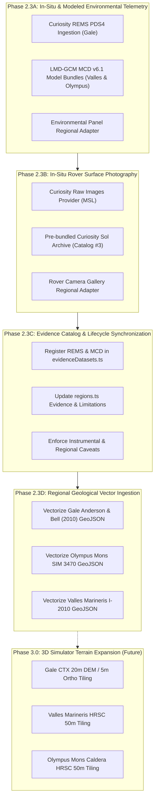

# PHASE 2.3 INTEGRATION ROADMAP
## Phased Implementation Strategy, Architecture Reuse, and Verification Standards

**Document Identifier:** `PHASE_2_3_INTEGRATION_ROADMAP.md`  
**Date:** November 15, 2026  
**Auditor:** Independent Planetary Science, GIS, and Software Architecture Review  
**Status:** Read-Only Technical Preflight Roadmap (Final Evidence Gate Verified)  
**Target Exploration Regions:** Jezero Crater, Gale Crater, Valles Marineris, Olympus Mons  
**Storage State:** Locally created untracked document in workspace root  

---

## 1. Executive Summary & Phased Implementation Strategy

Phase 2.3 bridges the gap between the clean, honest catalog state established in Phase 2.2 and a fully functional multi-region scientific research platform.

The strategy prioritizes integrations by:
1. **Scientific Value:** Delivering verifiable physical measurements and empirical data for hypothesis testing.
2. **Actual Accessibility:** Leveraging publicly accessible NASA PDS, USGS, and ESA archives without proprietary gates or fabricated endpoints.
3. **Technical Feasibility:** Minimizing client disk footprint, avoiding multi-gigabyte raw downloads where possible, and utilizing pre-processed JSON bundles.
4. **Reuse of Existing Architecture:** Reusing proven design patterns established for Jezero Crater (`medaProvider.ts`, `perseveranceImageryProvider.ts`, `marsDem.ts`, and `MissionContext.tsx`).

### 1.1 Recommended Phased Implementation Order

---

## 2. Detailed Integration Specifications

### 2.1 Stage 1: In-Situ & Modeled Environmental Telemetry (Phase 2.3A)

#### Integration 1.1 — MSL Curiosity REMS Environmental Bundle (Gale Crater)
- **Exact Dataset / Product:** Rover Environmental Monitoring Station (REMS) Calibrated Data Record (RDR) PDS4 Bundle (`urn:nasa:pds:msl_rems`).
- **Official Source:** NASA Planetary Data System (PDS) Atmospheres Node (Centro de Astrobiología / CSIC-INTA; Gómez-Elvira et al. 2012).
- **Geographic Coverage:** Local · Curiosity Rover Traverse across Gale Crater floor and Aeolis Mons lower slopes (4.58°S–4.75°S, 137.40°E–137.45°E).
- **Spatial / Temporal Resolution:** In-situ point sensor measurements recorded hourly at 1 Hz during 5-minute nominal sessions and 1 Hz continuous during designated monitoring windows; coverage spans Sol 10 (2012) to present (Sol 4300+).
- **Access Method:** Download validated PDS4 CSV / TAB files and XML labels from PDS Atmospheres (`https://atmos.nmsu.edu/PDS/data/PDS4/MSL/msl_rems/`).
- **Hardware & Channel Status Verification:**
  - *Boom 1:* Wind boards 2 and 3 damaged on Sol 0. Raw Boom 1 wind channels are inoperable and must be suppressed. Ground Temperature Sensor (GTS thermopile) and Air Temperature Sensor (ATS) operate nominally.
  - *Boom 2:* Wind boards operated initially; Board 1 (dice 1) failed on Sol 854; Board 2 failed on Sol 1485; Board 3 failed on Sol 1491; Board 1 fully failed on Sol 1504.
  - *Continuous Thermodynamic Channels:* Pressure, Air Temp, Ground Temp, Humidity, and UV flux operate continuously across all sols.
- **Required Processing:**
  - Author `backend/data-processing/processing/process_rems.py` mirroring `process_meda.py`.
  - Ingest representative sols demonstrating diurnal cycles: Sol 0010 (Bradbury Landing; Boom 2 wind active), Sol 0530 (The Kimberley; Boom 2 wind active), Sol 2000 (Vera Rubin Ridge; wind inoperative / suppressed; thermodynamic channels active).
  - Extract ambient pressure (`P`), ground temperature (`GT`), air temperature (`AT`), relative humidity (`HUM`), and UV flux (`UV`).
  - Compile output into `/public/data/rems_processed_bundle.json` (~500–700 KB).
- **Existing Application Integration Point:**
  - Create `frontend/src/services/providers/remsProvider.ts` mirroring `medaProvider.ts`.
  - Update `InvestigationPage.tsx` environmental section to dynamically mount `remsProvider` when `selectedRegion.id === "gale-crater"`.
- **Expected Implementation Difficulty:** **Medium**.
- **Explicit Acceptance Criteria:**
  1. JSON file committed at `frontend/public/data/rems_processed_bundle.json`.
  2. Sols 0010, 0530, and 2000 present with validated sensor fields.
  3. Raw Boom 1 wind speed channels suppressed.
  4. Sols 0010 and 0530 display Boom 2 reconstructed wind with single-boom aerodynamic caution badge.
  5. Sol 2000 displays missing/inoperative wind indicator while plotting continuous temperature, pressure, humidity, and UV curves.
  6. Automated unit tests assert pressure values between 700 Pa and 950 Pa and temperatures between 140 K and 300 K.

#### Integration 1.2 — LMD-GCM MCD v6.1 Regional Climatological Profiles (Valles Marineris & Olympus Mons)
- **Exact Dataset / Product:** European Mars Climate Database v6.1 (LMD / CNES / ESA; Forget et al. 1999; Millour et al. 2018).
- **Official Source:** Laboratoire de Météorologie Dynamique (LMD), Paris, France (`http://www-mars.lmd.jussieu.fr/`).
- **Geographic Coordinates & Elev Datum:** 
  - Valles Marineris (Melas Chasma): -9.80° Lat, 283.60° Lon (76.40°W), Elevation -4,500 m to -5,000 m (MOLA datum).
  - Olympus Mons (Summit Caldera): 18.65° Lat, 226.20° Lon (133.80°W), Elevation +21,229 m (MOLA datum).
- **Contextual Physical Ranges:**
  - Melas Chasma: ~800–1,200 Pa (~8.0–12.0 mbar; seasonal mean ~950–1,150 Pa).
  - Olympus Mons: ~50–85 Pa (~0.50–0.85 mbar; nominal mean ~67–72 Pa).
- **Mandatory Reproducibility Requirement:** Prior to Phase 2.3A implementation, reproducible netCDF or ASCII model extractions must be executed via the official MCD v6.1 web interface or Python API (`mcd_python`), recording Mars Year, Dust Scenario (standard climatology), Solar Longitude $L_s \in \{0^\circ, 90^\circ, 180^\circ, 270^\circ\}$, 24 LTST hourly steps, surface pressure, atmospheric density, near-surface temperature, column water vapor, and dust optical depth. No fabricated or guessed numerical tables may be packaged into JSON.
- **Required Processing:**
  - Tabulate reproducible outputs into `/public/data/valles_mcd_bundle.json` and `/public/data/olympus_mcd_bundle.json` (~80 KB each).
- **Existing Application Integration Point:**
  - Create `frontend/src/services/providers/mcdClimateProvider.ts`.
  - In `InvestigationPage.tsx`, render modeled atmospheric profiles with an explicit badge: `"LMD-GCM MCD v6.1 Orbital Climatology (No In-Situ Lander)"`.
- **Expected Implementation Difficulty:** **Low-Medium**.
- **Explicit Acceptance Criteria:**
  1. JSON files committed at `/public/data/valles_mcd_bundle.json` and `/public/data/olympus_mcd_bundle.json`.
  2. Provenance block records exact MCD version, query date, solar longitudes ($L_s$), and model run parameters.
  3. Valles Marineris pressure values assert within [800, 1250] Pa.
  4. Olympus Mons pressure values assert within [45, 95] Pa.
  5. UI renders prominent "Modeled Orbital Climatology" badge; zero rover telemetry terminology rendered for these regions.

---

### 2.2 Stage 2: In-Situ Rover Surface Photography (Phase 2.3B)

#### Integration 2.1 — MSL Curiosity Surface Imagery Provider (Gale Crater)
- **Exact Dataset / Product:** NASA/JPL MSL Curiosity Raw Surface Images Feed (Catalog #3 — Surface Imagery).
- **Official Source:** NASA/JPL-Caltech Mars Science Laboratory Raw Images Service (`https://mars.nasa.gov/rss/api/?feed=raw_images&category=msl&feedtype=json`).
- **Geographic Coverage:** Local · Curiosity traverse in Gale Crater.
- **Spatial Resolution:** Sub-millimeter outcrop texture (MAHLI), high-resolution telephoto color (Mastcam-100), medium-angle color (Mastcam-34), and wide-angle stereoscopic (Navcam).
- **Access Method:** Public REST JSON feed with local fallback bundle.
- **Catalog Distinction:** Explicitly separated from empirical measurement tables (Catalog #2); represents visual surface morphology.
- **Required Processing:**
  - Select and curate 100–120 scientifically landmark images across key geological formations:
    - Yellowknife Bay (Mudstone lacustrine strata; Sols 120–200).
    - The Kimberley (Sandstone cross-bedding; Sol 530).
    - Namib Dune (Active eolian dunes; Sols 1170–1220).
    - Vera Rubin Ridge (Hematite-bearing ridge; Sols 1800–2050).
    - Glen Torridon (Clay-bearing trough; Sols 2300–2600).
    - Gediz Vallis Ridge (Debris flow deposits; Sols 3800–4100).
  - Pre-bundle metadata into `/public/data/curiosity_surface_imagery.json` (~250 KB) mirroring `perseverance_surface_imagery.json`.
- **Existing Application Integration Point:**
  - Create `frontend/src/services/providers/curiosityImageryProvider.ts` mirroring `perseveranceImageryProvider.ts`.
  - Wire into `InvestigationPage.tsx` and `EvidenceInspectorPage.tsx` when `selectedRegion.id === "gale-crater"`.
- **Expected Implementation Difficulty:** **Medium**.
- **Explicit Acceptance Criteria:**
  1. JSON catalog committed at `/public/data/curiosity_surface_imagery.json`.
  2. Sols 10, 120, 530, 1170, 1800, 2300, 3800 represented with valid image URLs and credits.
  3. Camera filters correctly support `MASTCAM_100`, `MASTCAM_34`, `NAVCAM`, `MAHLI`.
  4. Gallery displays contextual warning that visual bedding/textures require paired chemical/spectroscopic analyses for mineral confirmation.

---

### 2.3 Stage 3: Evidence Catalog & Regional Synchronization (Phase 2.3C)

#### Integration 3.1 — Registering New Datasets in `evidenceDatasets.ts`
- **Actions:**
  - Register `msl_rems_env` in `EVIDENCE_DATASETS` with `coverageScope: "LOCAL_INSITU"`, `supportedRegionIds: ["gale-crater"]`, `operationalStatus: ["REGISTERED", "ACCESSIBLE", "DOWNLOADED", "VALIDATED", "INTEGRATED"]`.
  - Add `GENUINE_LOCAL_DATASET_IDS.push("msl_rems_env", "valles_mcd_bundle", "olympus_mcd_bundle")`.
  - Register `valles_mcd_bundle` and `olympus_mcd_bundle` in `EVIDENCE_DATASETS` with `coverageScope: "REGIONAL"`.
  - Register `msl_curiosity_surface_imagery` in the Surface Imagery catalog contract.
  - In `regions.ts`, update `gale-crater.evidenceDatasets` to include `msl_rems_env` with role `direct_quantitative`.
  - Update `gale-crater.rover.hasSurfaceImagery: true` and assign `surfaceImageryCatalogId: "curiosity_surface_imagery"`.
- **Expected Implementation Difficulty:** **Low**.
- **Explicit Acceptance Criteria:**
  1. Automated execution of `validateAllDatasetsLifecycle()` reports `totalErrors === 0`.
  2. Automated test suite asserts zero cross-region dataset leakage.

---

### 2.4 Stage 4: Regional Vector Geological Mapping (Phase 2.3D)

#### Integration 4.1 — Vector GeoJSON Ingestion for Non-Jezero Regions
- **Products:**
  - Gale Crater: Anderson & Bell (2010; *Mars*) Mount Sharp units (Lower Formation, Sulfate Unit, Capping Unit). Target: `/public/data/gale_geology_anderson2010.geojson`.
  - Olympus Mons: USGS SIM 3470 (*Mouginis-Mark, 2021*) Caldera floor and rim units. Target: `/public/data/olympus_geology_sim3470.geojson`.
  - Valles Marineris: USGS Map I-2010 (*Witbeck et al., 1991*) Melas Chasma canyon wall, floor, and interior layered deposit (ILD) units. Target: `/public/data/valles_geology_i2010.geojson`.
- **Nature of Work:** This is a **data production and cartographic digitization task**, separate from application code engineering. It requires converting published GIS shapefiles or georeferenced raster map plates into clean, lightweight GeoJSON polygons (<50 KB each).
- **Required Processing:**
  - Convert map plates into clean polygon geometries.
  - Standardize properties: `unit_symbol`, `unit_name`, `age_epoch`, `lithology`, `citation`.
- **Existing Application Integration Point:**
  - Place files in `/public/data/`.
  - In `frontend/src/data/regions.ts`, populate `geologicalDatasets: [...]` for the respective regions with `status: "integrated_active"`.
  - `MarsMap.tsx` automatically renders vector layers when `region.geologicalDatasets` contains active items.
- **Expected Implementation Difficulty:** **Medium-High**.
- **Explicit Acceptance Criteria:**
  1. GeoJSON files validate against RFC 7946 specifications with zero self-intersecting polygon errors.
  2. Geometries lie strictly within regional bounding boxes.
  3. Vector layers render properly in `MarsMap.tsx` on region switch.

---

### 2.5 Stage 5: 3D Simulator Terrain Expansion (Phase 3.0 Milestone)

*Note: Deferred to Phase 3.0. Excluded from Phase 2.3 implementation.*

#### Architectural Blueprint:
- Download controlled regional DEM GeoTIFFs (Gale 20 m CTX DEM, Valles 50 m HRSC DTM, Olympus Mons 50 m HRSC DTM).
- Reproject to Equirectangular Mars 2000.
- Execute DEM slicing script:
  - Generate `manifest.json` with accurate cell sizes, bounding coordinates, and `heightMin` / `heightMax`.
  - Quantize into 16-bit binary tiles (`height/<tx>_<ty>.u16`) and low-resolution `overview.u16`.
  - Slice matching orthomosaics into JPEG tiles (`tex/<tx>_<ty>.jpg`) and `overview.jpg`.
- Register new environments in `frontend/src/simulator/environments/catalog.ts` and set `simulatorAvailability: "AVAILABLE"`.

---

## 3. Strict Verification & Integrity Checkpoints for Phase 2.3

To ensure that future implementations maintain the rigor achieved in Phase 2.2, all pull requests or phase increments must satisfy the following checklist:

| Verification Checkpoint | Automated Tool / Script | Acceptance Threshold |
| :--- | :--- | :--- |
| **Catalog Lifecycle Invariants** | `node frontend/scratch/run_audit_tests.cjs` | 0 lifecycle errors; zero unverified `DOWNLOADED` claims. |
| **Multi-Region Assertions** | `node verify_phase1_multiregion.mjs` | All 25 multi-region tests pass. |
| **Geological Reference Integrity**| `node verify_phase2_catalog.mjs` | All 36 Phase 2 catalog assertions pass. |
| **New Phase 2.3 Validation Suite**| `verify_phase2_3_integration.mjs` | 100% assertions pass for REMS, MCD, and Curiosity imagery. |
| **TypeScript Type Checking** | `cd frontend && npx tsc --noEmit` | Clean run; 0 type errors. |
| **Production Vite Build** | `cd frontend && npm run build` | Clean production bundle generated in `< 10` seconds. |
| **Git Diff Check** | `git diff --check HEAD` | Clean diff check; 0 trailing whitespace or conflict markers in new files. |

---

## 4. Phase 2.3 Readiness Verdict

**Verdict:** **READY WITH EXPLICIT LIMITATIONS**

- **Part A Audit Closure:** Resolved. The exit code 1 in `git diff --check` was confirmed to originate exclusively from a single pre-existing trailing space on line 366 of `ARCHITECTURE.md` introduced prior to Phase 2.2. Zero Phase 2.2 files contain whitespace errors or conflict markers.
- **Part B Preflight Investigation:** Complete and verified across all primary NASA PDS, USGS, ESA PSA, and LMD-GCM sources.
- **Explicit Limitations Recorded:**
  1. REMS wind sensor data is valid only prior to Sol 1485–1504; raw Boom 1 channels must be suppressed; Boom 2 aerodynamic reconstruction caution applies.
  2. MCD v6.1 model outputs must be generated via reproducible query scripts prior to packaging into JSON bundles.
  3. Geological GeoJSON vectorization is decoupled as Phase 2.3D.
  4. 3D terrain simulation expansion is decoupled as Phase 3.0.
- **Action Required:** Await human review and formal approval before commencing Phase 2.3A implementation.
